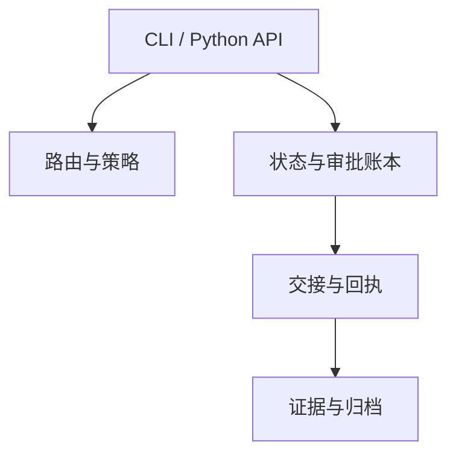

<div align="center">
  
  <h1>TsaoSciResearcher</h1>
  <p><strong>证据优先的科研策略、数理合同、受控交接与验证控制层</strong></p>
  <p>科学问题 → 观测量 → 模型合同 → 证据合同 → 受控外部执行 → 回执 → 验收证据</p>

[English](README.md) · [文档](docs/index.md) · [架构](docs/ARCHITECTURE.md) · [数理合同](docs/MATHEMATICAL_CONTRACTS.md) · [验证](docs/VALIDATION.md) · [视觉图谱](docs/VISUAL_ATLAS.zh-CN.md)

[](https://github.com/SUNHAOJUN22/TsaoSciResearcher/actions/workflows/ci.yml)
</div>

## 项目愿景：科学问题、数理合同与可追溯证据


> AI 生成概念示意图。证据三元组 E=(E+, E−, E0)、最弱质量门 G=min(g_i) 和 H=SHA256(bytes) 对应代码合同；图片表达愿景与导航，不是计算所得科研数据或自动科学批准。


> **正式版本 0.7.4 · 验收加固 main** · Apache-2.0 · Python 3.10–3.13 · 确定性 CLI 与 Python API

## 1. 这个仓库究竟是什么

TsaoSciResearcher 是一个**科研控制层**。它把定义不足的科研问题转化为可追踪、可证伪、可复核的研究策略，负责确定性问题路由、能力合同检索、科研质量检查、策略生成、项目状态管理、校验和绑定的外部执行交接、执行回执验证和可复现归档。

它**不是** DFT、量子化学、分子动力学、CFD、FEM、流程模拟、HPC 或实验室求解器。一个策略、一条方程、一个 handoff 文件、一个 PASS 标签或一张 AI 图，都不能证明真实计算或实验已经发生。

当前实现规模由机器事实文件约束：

| 交付事实 | 已核验值 |
|---|---:|
| 能力合同 | **341** |
| 保留的旧版/通用合同 | **158** |
| 保留的工作簿命名 | **322** |
| 领域计算/工程合同 | **164** |
| 通用领域占位项 | **0** |
| 运行时新增能力 | **19** |
| 主工作流 | **15** |
| JSON Schema | **20** |
| 领域包 | **7** |
| 登记的历史概念图谱资产 | **38** |
| 新增中英文愿景图 | **2** |

验收证据：[README 审计](docs/README_AUDIT_REPORT.md)、[能力覆盖矩阵](docs/CAPABILITY_COVERAGE_MATRIX.md)、[架构映射](docs/README_ARCHITECTURE_MAPPING.md)、[数理合同](docs/MATHEMATICAL_CONTRACTS.md)、[数理合同 Schema](schemas/v2/mathematical-contract-registry.schema.json)、[验证证据](docs/VALIDATION_EVIDENCE.json)、[HTML 仪表板](docs/test-dashboard.html)与 [SVG 仪表板](docs/test-dashboard.svg)。

> 当前中文愿景为 **AI 生成概念示意图**。38 项旧图谱资产作为历史概念文档保留，生成的测试仪表板则描述软件证据；两者职责不同，都不能替代科学测量数据。中文正文使用中文愿景图，英文历史图以归档链接保留。

## 2. 架构与职责边界



[英文归档图：科研控制架构](docs/assets/ai/research_os_architecture.svg)
[英文归档图：渐进式路由与加载](docs/assets/ai/progressive_routing_loading.svg)
[英文归档图：计算交接边界](docs/assets/ai/computation_handoff_boundary.svg)

典型研究链路：

```text
科学问题
    ↓
决策关键观测量 + 单位 + 验收阈值
    ↓
状态变量 + 控制规律 + 约束
    ↓
最低充分、可证伪模型
    ↓
证据 / 适用域 / 可辨识性 / 尺度桥质量门
    ↓
合格人工评审
    ↓
校验和绑定的外部交接
    ↓
执行回执 + 可独立复核证据
```

## 运行时保证与实际使用流程

代码明确区分研究计划、用户提供的执行声明、已核验的本地字节和独立科学验收。`state.verify()` 已接入真正的回执核验器；`quality` 只有得到实际 `project_root` 并成功解析登记记录后，才能报告本地双向追溯通过。

| 入口 | 实际检查 | 结果能说明什么 |
|---|---|---|
| `create_handoff()` | 项目、方法、尺度、有界输入清单、文件长度和 SHA-256 | 已准备的外部计算合同 |
| `record_receipt()` | 已登记且就绪的交接、当前输入字节、参数向量、引擎字段、时间、退出状态和输出 | 与保留输入快照绑定的用户执行声明 |
| `verify()` / `verify_receipts()` | 合法事件历史、输出当前字节、输入保留快照、登记关系和审批绑定 | 本地状态及工件完整性 |
| `quality` / `check_evidence_traceability()` | 登记声明文字、双向证据边、本地定位符与校验和、每个回执对应的真实输出 | 全部检查成功才是 `LOCAL_ARTIFACT_LINKS_VERIFIED` |
| `transition(..., "accepted")` | 新审批引用与本项目这一次确切状态转换绑定 | `DECLARED_NOT_IDENTITY_VERIFIED`，不认证外部人员身份 |
| `capsule export --mode full` | 确定性完整清单、字节哈希、状态和回执核验 | 包含原输入保留字节的可迁移完整性归档 |

### 安装与升级

本仓库要求 **Python 3.10 或更新版本**；永久 CI 覆盖 Linux 3.10/3.12/3.13 与 Windows 3.12。将隔离环境放在源码目录外，避免依赖和构建产物混入源码清单：

```bash
python -m venv ../tsao-researcher-env
# POSIX shell；Windows 使用 ../tsao-researcher-env/Scripts/Activate.ps1
. ../tsao-researcher-env/bin/activate
python -m pip install -r requirements-ci.lock
python -m pip install -e . --no-deps
python -m pip check
python -m tsao_researcher --version
```

CI 锁显式固定 `certifi==2026.10.19`、`pip==26.2.0`，每次完整 CI 继续对实际解析环境进行漏洞审计。本仓库没有 MCP 运行时依赖。旧回执若缺少 `input_snapshots`，或旧审批缺少事件与作用域绑定，将被新核验器明确拒绝。保留旧归档，仅依据仍然存在的原始字节与真实审批引用重建新声明；补填字段不能证明历史计算曾经发生。未提供引擎版本时保留明确的 `null`，不臆造版本号。

### 可执行初始化与交接示例

下面创建的是**演示输入和已准备的交接合同**，不是求解器结果：

```bash
python -m tsao_researcher init --name demo \
  --question "什么计算可以区分候选机理？" --output ./research-demo
python - <<'PY'
from pathlib import Path
from tsao_researcher.handoff import create_handoff
root = Path("research-demo/.tsao-research")
(root / "data/input.dat").write_text("仅供演示的输入\n", encoding="utf-8")
create_handoff(root, "computation/job.json", "什么计算可以区分候选机理？",
    "能量差", "quantum", ["DFT"], ["data/input.dat"],
    scale="electronic", evaluation_metrics=["以 eV 表示的能量差"],
    expected_outputs=["已收敛能量与方法来源"])
PY
python -m tsao_researcher verify ./research-demo
```

另行运行所选外部引擎，保存真实输入、输出与日志，再记录真实参数向量、软件版本、环境和起止时间。第 8 节 `receipt record` 示例要求对应文件已经存在。可重复的 `--command` 组成参数向量，本命令不会启动 shell 或求解器。推进状态与导出归档之前，执行 `receipt verify` 和 `verify`。

### 输入快照与字节完整性

对于交接输入 $i$，实际实现核对：

$$
I_i=\left(\operatorname{size}(B_i),\operatorname{SHA256}(B_i)\right),
\qquad S_i=\texttt{artifacts/input-snapshots/}\operatorname{SHA256}(B_i).
$$

`input_snapshots.py` 在记录回执之前核对当前输入与交接清单，流式复制并核验复制过程中的长度和哈希，拒绝符号链接路径，不覆盖已存在却发生篡改的内容寻址快照。之后核验回执使用保留的快照；修改工作输入不会改写旧回执所绑定的历史输入。快照缺失、篡改或绑定不一致都会失败。成功回执必须有非空且哈希核验过的输出；失败执行始终记录为失败，允许没有输出。

输出 $j$ 的本地字节绑定要求：

$$
\operatorname{size}(B_j)=s_j\ \land\
\operatorname{SHA256}(B_j)=h_j.
$$

摘要只证明当前字节与记录清单一致，不能证明这些字节确实由外部引擎产生，也不能证明所报告物理结果正确。元数据归档排除 `data`、`figures`、`artifacts` 的原始字节；完整归档包含输入保留快照。按证据移交需求选择模式。

### 事件链、合法转换与审批声明

每个事件的规范化内容包含前驱哈希：

$$
h_i=\operatorname{SHA256}\!\left(\operatorname{canonicalJSON}(e_i\setminus\{\texttt{event\_hash}\})\right),
\qquad e_i[\texttt{previous\_event\_hash}]=h_{i-1}.
$$

核验还要求初始化状态为 `proposed`、转换边合法、前后状态连续、带时区的时间顺序正确、项目身份一致、项目最终头与链头一致。把非法转换重新计算哈希仍然无法通过。常规路径为 `proposed → planned → running → completed → checked → validated → accepted`；代码保留相应拒绝与取代分支。

审批账本绑定项目、作用域、目标状态、转换事件哈希、时间和引用。重复或孤立引用、外项目记录、撤销审批、非布尔撤销标志会被拒绝；`accepted` 要求本次转换使用新的审批引用。本地记录明确标记 `DECLARED_NOT_IDENTITY_VERIFIED`，身份认证与独立科学签署不在本声明 API 的保证范围内。v16/v17 重放辅助函数接收肯定布尔声明时，同样只返回 `ACCEPTANCE_DECLARED_UNVERIFIED` 或 `SIGNED_RECEIPT_DECLARED_UNVERIFIED`。

### 根据真实项目解析证据

在 `kind: "evidence-traceability"` 的质量请求中设置 `spec.project_root`。提交的声明文字与证据 ID 必须匹配 `claims.jsonl`；`evidence.jsonl` 中每项支持证据必须反向引用该声明。本地来源类型、定位符、校验和和当前字节都需要实际解析。标记为 `execution-receipt` 的证据必须对应所引用成功回执的真实输出，而且**每个**引用回执都必须绑定提供的执行证据：

$$
C\leftrightarrow E_i,\qquad
\forall R_k\in R,\ \exists E_i:\
\operatorname{path}(E_i)\in\operatorname{outputs}(R_k)
\land h(E_i)=h_{R_k}.
$$

缺少 `project_root` 时，即使自报“来源已验证”“回执已验证”，结果仍为 `WARN / UNVERIFIED_DECLARATION`。实际登记缺失或不一致则返回 `BLOCK`。背景、零结果、反驳或计划交接不能充当正向支持证据；网页和论文定位声明不会被冒充为已核验本地文件。`LOCAL_ARTIFACT_LINKS_VERIFIED` 只说明本地身份与完整性，不自动证明科学结论。

### 数量、不确定度与因果语言

`compare_quantities()` 当前支持压力单位 `Pa`、`kPa`、`MPa`、`bar` 和温度 `K`，核对量纲，并在单位缩放之前和之后检查数值有限性：

$$
v_{\mathrm{SI}}=s_u v_u,\qquad
\operatorname{finite}(v_u)\land\operatorname{finite}(v_{\mathrm{SI}}).
$$

布尔量、数字字符串、超出有限数值范围的整数和换算溢出都会被拒绝。当前全部单位因子均为整数，因此整数输入在缩放和比较时保留精确差异：`2**53 Pa` 小于 `(2**53 + 1) Pa`。浮点输入仍采用普通二进制浮点舍入；相等比较不代表不确定度容差。

公开 JSON/JSONL 读取、质量请求、交接与回执验证、项目登记表及胶囊清单均拒绝重复键、非有限数，以及会静默变为零的非零十进制数值。YAML 项目元数据及兼容校验入口同样检查数值与显式重复键，并保留合法的 YAML 合并覆盖语义：

$$
x\ne0\ \land\ \operatorname{fl}(x)=0
\quad\Longrightarrow\quad\text{拒绝输入}.
$$

真实带符号零和 `5e-324` 等可表示的次正规数仍然有效。对于超出范围的测量，应在序列化前选择合适单位，或将其保留为有明确说明的文本来源证据；不得替换成零值测量。如果调用方事先已经把数值舍入为零，接收端无法恢复原始十进制数值。

第 3 节数理注册表中的一般不确定度和尺度方程是咨询合同，运行时不会依据这些公式自动执行雅可比估计、贝叶斯推断、CFD 或 DFT。误差相关时必须保留协方差项，一阶传播前应说明局部线性近似。

确定性因果语言防线把否定限制在被否定的标记附近；“不能证明因果”不能掩盖同一段中另一条肯定“C 导致 D”的表述。支持 `使得`、`导致/導致`、`驱动/驅動`、`决定/決定` 等简繁中文标记。检查仍依赖设计、对照、时序与混杂控制声明，不是通用自然语言证明器。

## 3. Schema 约束的机器可读数理合同

`math` 命令公开八类稳定的中英文数理合同。当前每个响应在输出前都会通过包内 Draft 2020-12 Schema 校验。

```bash
python -m tsao_researcher math
python -m tsao_researcher math --schema
python -m tsao_researcher math --contract decision-readiness --language en
python -m tsao_researcher math --contract quantity-dimension --language zh-CN
python -m tsao_researcher math --contract uncertainty-budget --output contract.json
python scripts/validate_mathematical_contracts.py --check
```

每个合同响应固定声明科研真实性边界：

```json
{
  "schema_version": "1.0",
  "schema_id": "https://sunhaojun22.github.io/TsaoSciResearcher/schemas/v2/mathematical-contract-registry.schema.json",
  "advisory_only": true,
  "solver_executed": false,
  "automatic_approval": false
}
```

规范 Schema 位于 [`schemas/v2/mathematical-contract-registry.schema.json`](schemas/v2/mathematical-contract-registry.schema.json)，安装包在 `tsao_researcher/data/schemas/` 中携带逐字节一致的镜像，因此安装后的 CLI 也可以离线验证同一个合同。

[英文归档图：数理合同 Schema 验证流水线](docs/assets/ai/mathematical_contract_schema_pipeline.svg)

### 3.1 能力排序抽象

$$
S(c\mid q,o,e)=w_qR(q,c)+w_oR(o,c)+w_eM(e,c)-w_xC(c)
$$

- $c$：候选能力
- $q$：科研问题
- $o$：决策关键观测量
- $e$：已声明证据上下文
- $C(c)$：冲突或排除惩罚

该式用于解释确定性路由如何分解，而不是一个已经拟合的统计模型。候选方法必须同时满足问题相关、能够产生目标观测量、与现有证据兼容，并且不被负向语义排除。

### 3.2 数量、单位与量纲合同

$$
x=(v,u,d),\qquad d_{\mathrm{left}}=d_{\mathrm{right}}
$$

进行定量比较时应明确数值 $v$、单位 $u$ 与物理量纲 $d$。缺失单位进入复核；量纲不相容直接阻断比较。

### 3.3 适用域与外推

$$
r_{\mathrm{extra}}=
\frac{d(x,\mathcal A)}{\max(s_{\mathcal A},\varepsilon)}
$$

其中 $x$ 是目标条件，$\mathcal A$ 是声明适用域，$s_{\mathcal A}$ 是特征尺度。目标离适用域越远，要求的迁移证据和不确定性膨胀越强。运行时不会在没有数据时伪造一个数值距离。

### 3.4 证据三分与冲突账本

$$
E=(E_+,E_-,E_0),\qquad
\kappa=\mathbf 1[E_+\neq\varnothing\land E_-\neq\varnothing]
$$

支持、挑战与未决证据必须保持分离；一个正向结果不能静默抹掉相反证据。

### 3.5 机制与参数可辨识性

$$
D_{ij}(O,C)>\tau
\qquad\text{或}\qquad
\operatorname{rank}(J_\theta)=p
$$

机制选择需要区分性观测量；唯一参数结论需要足够的敏感性秩。真实数值雅可比矩阵仍属于外部分析任务。

### 3.6 决策观测量不确定性预算

$$
\Sigma_y\approx
J\Sigma_\theta J^{\mathsf T}
+\Sigma_{\mathrm{num}}
+\Sigma_{\mathrm{sample}}
+\Sigma_{\mathrm{model}}
+\Sigma_{\mathrm{transfer}}
$$

不确定性必须传播到真正用于接受或拒绝的观测量；参数、数值、采样、模型形式和尺度传递误差不能被压缩成一个来源不明的“置信度”。

### 3.7 多尺度桥接误差预算

$$
U_{\mathrm{bridge}}^2=
U_{\mathrm{source}}^2+
U_{\mathrm{mapping}}^2+
U_{\mathrm{closure}}^2+
U_{\mathrm{target}}^2
$$

上述平方和要求各项是同一输出单位下相互不相关的标准不确定度；存在相关性时必须加入交叉协方差项。一阶传播仅为局部线性近似。微观结果不能直接跳到工程结论。每个尺度桥必须有可测桥接变量、映射假设、闭合验证与目标尺度验收证据。

### 3.8 保守决策就绪度

$$
G=\min\left(
 g_{\mathrm{quantity}},
 g_{\mathrm{applicability}},
 g_{\mathrm{evidence}},
 g_{\mathrm{identifiability}},
 g_{\mathrm{bridge}}
\right)
$$

最弱的强制门控制整体就绪度：

```text
BLOCK < REVIEW < PASS
```

软件 `PASS` 只表示声明范围内没有剩余软件阻断项，不等于物理真实性证明，也不能绕过合格科研人员的人工评审。

[英文归档图：数理合同目录](docs/assets/ai/mathematical_contract_registry.svg)
[英文归档图：决策就绪度格](docs/assets/ai/decision_readiness_lattice.svg)
[英文归档图：不确定性传播预算](docs/assets/ai/uncertainty_propagation_budget.svg)
[英文归档图：多尺度桥接误差预算](docs/assets/ai/multiscale_bridge_error_budget.svg)

详细中英文解释：[docs/MATHEMATICAL_CONTRACTS.md](docs/MATHEMATICAL_CONTRACTS.md)。

## 4. 科学模型还原与方法选择策略

TsaoSciResearcher 从决策问题背后的物理结构选择方法，而不是从流行软件名称倒推方法。

一般状态模型：

$$
\dot{x}=f(x,u,\theta)+\epsilon_{\mathrm{model}},
\qquad
y=h(x,\theta)+\epsilon_{\mathrm{measurement}}
$$

策略至少应声明：

1. 状态变量 $x$、控制量 $u$ 与参数 $\theta$；
2. 决策观测量 $y$ 与验收阈值；
3. 守恒量、储库、边界条件和初始条件；
4. 能够证伪候选机制的最低充分模型；
5. 验证、不确定性和升级规则。

对固定控制体中的单位质量物理量 $\phi$，令 $\rho$ 为密度，$\mathbf J_\phi$ 为包含对流和扩散的总向外通量，$s_\phi$ 为单位体积源项：

$$
\frac{\mathrm d}{\mathrm dt}\int_{\Omega}\rho\phi\,\mathrm dV
+\int_{\partial\Omega}\mathbf J_\phi\cdot\mathbf n\,\mathrm dA
=\int_{\Omega}s_\phi\,\mathrm dV
$$

该方程并不意味着网格、物性模型或求解器已经存在；它定义了外部 CFD、FEM、输运或流程模拟交接前必须明确的守恒和闭合结构。

### 最低充分方法阶梯

| 问题类型 | 起始策略 | 何时升级 |
|---|---|---|
| 电子结构 / 缺陷 / 界面 | 收敛的团簇或周期 DFT 策略 | 泛函、尺寸或参考态敏感性成为决策因素 |
| 反应机理 / 选择性 | 反应路径能量 + 微观动力学骨架 | 缺失路径、溶剂/动力学或输运耦合仍未解决 |
| 构象 / 自由能 | 系综 MD/MC 策略 + 收敛判据 | 采样或力场证据不足 |
| 形貌 / 相演化 | 标度 / SCFT / CGMD / DPD / 相场策略 | 映射或闭合失败 |
| 流动 / 传热 / 传质 | 解析 / 控制体 / 降阶模型 | 几何、失稳或闭合要求 CFD/多物理场 |
| 力学 / 断裂 | 降阶力学或 FEM 策略 | 本构不可辨识或局域化主导 |
| 反应工程 | 质量/能量衡算 + 动力学/群体模型 | RTD、混合或装置数据耦合成为关键 |
| 混合多尺度问题 | 最低成本可证伪模型 | 经验证的桥接变量支持继续升级 |

[英文归档图：第一性原理策略阶梯](docs/assets/ai/first_principles_strategy_ladder.svg)
[英文归档图：科研方法决策树](docs/assets/ai/scientific_problem_method_decision_tree.svg)
[英文归档图：多尺度科研流水线](docs/assets/ai/multiscale_science_pipeline.svg)

## 5. Scientific Passport 与科研诚信门

策略护照可以抽象为：

$$
\mathcal P=\{M,E,U,A,I,B,V,F\}
$$

其中 $M$ 为模型合同，$E$ 为证据，$U$ 为不确定性，$A$ 为适用域，$I$ 为可辨识性，$B$ 为尺度桥，$V$ 为验证，$F$ 为证伪条件。

即使所有软件门都为绿色，科研结论仍保持建议性，不能自动替代人工科学判断。

[英文归档图：Scientific Passport 矩阵](docs/assets/ai/scientific_passport_matrix.svg)
[英文归档图：证据成熟度阶梯](docs/assets/ai/evidence_maturity_ladder.svg)
[英文归档图：决策就绪度门](docs/assets/ai/decision_readiness_gate.svg)
[英文归档图：主动证据闭环](docs/assets/ai/active_evidence_learning_loop.svg)
[英文归档图：数量与量纲合同](docs/assets/ai/quantity_dimension_contract.svg)
[英文归档图：适用域外推防线](docs/assets/ai/applicability_extrapolation_guard.svg)
[英文归档图：证据冲突](docs/assets/ai/evidence_conflict_resolution.svg)
[英文归档图：机制可辨识性](docs/assets/ai/mechanism_identifiability_gate.svg)
[英文归档图：不确定性验证](docs/assets/ai/uncertainty_quantification_validation.svg)
[英文归档图：科研诚信因果防线](docs/assets/ai/scientific_integrity_causality_guard.svg)

## 6. 验收策略：exact baseline + focused delta

仓库支持三种验证范围：

- `preflight`：当前 checkout 的本地预检，CI 专属门保持 `NOT_RUN/PARTIAL`；
- `current-tree`：由外部 CI 对当前树执行端到端验证，并绑定具体 commit；
- `composite`：固定一个 exact-tree 全仓库基线，再叠加 SHA-256 绑定的当前聚焦回归。

当前签入记录采用 **preflight**：绑定当前源码摘要，但完整 CI 资格在外部运行产生证明前保持 **PARTIAL**。历史 composite 基线和 Schema/CLI 聚焦记录保留供参考，不证明变更后的当前树已经通过。

```text
validation_scope = preflight
status = PARTIAL
current_end_to_end_ci = NOT_RUN until externally attested
```

preflight 模式的 `SHA256SUMS` 记录从完整 checkout 重新计算的摘要；composite 模式则明确延后新的全树摘要。两种范围都不允许把旧 PASS 复制到新代码上。

详见 [验证证据](docs/VALIDATION_EVIDENCE.json)、[基线记录](docs/VALIDATION_BASELINE.json) 和 [当前聚焦回归](docs/CURRENT_CHANGE_REGRESSION.json)。

[英文归档图：可复现质量门](docs/assets/ai/reproducibility_quality_gates.svg)
[英文归档图：兼容性矩阵](docs/assets/ai/installation_compatibility_matrix.svg)
[英文归档图：供应链证明](docs/assets/ai/supply_chain_release_attestation.svg)

## 7. 核心 CLI 使用方法

```bash
python -m pip install -r requirements-ci.lock
python -m pip install -e . --no-deps
python -m pip check

python -m tsao_researcher --version
python -m tsao_researcher route "run an actual DFT calculation"
python -m tsao_researcher search "molecular dynamics" --limit 3
python -m tsao_researcher quality examples/scientific-quality-check.json
python -m tsao_researcher strategy \
  "Can two mechanisms be discriminated?" \
  --observable "rate constant 1/s" \
  --condition "350 K" \
  --evidence "independent measurement"
python -m tsao_researcher math --schema
python -m tsao_researcher math --contract decision-readiness --output contract.json
python scripts/validate_mathematical_contracts.py --check
```

## 8. 外部执行边界

TsaoSciResearcher 准备并验证执行前后的证据，但不会冒充外部引擎：

```text
已验证策略
    ↓
校验和绑定 handoff
    ↓
外部引擎 / 仪器 / 实验室
    ↓
用户提供的执行回执 + 输出哈希
    ↓
回执验证
    ↓
合格科研人员独立验收
```

[英文归档图：项目状态机](docs/assets/ai/project_state_machine.svg)
[英文归档图：项目账本与来源](docs/assets/ai/project_ledgers_provenance.svg)
[英文归档图：证据主张图](docs/assets/ai/evidence_claim_graph.svg)
[英文归档图：证据引文完整性](docs/assets/ai/evidence_citation_integrity_loop.svg)
[英文归档图：人工审批边界](docs/assets/ai/human_approval_acceptance_boundary.svg)

示例：

```bash
python -m tsao_researcher receipt record . \
  --handoff computation/job.json \
  --engine external-engine \
  --engine-version 1.0 \
  --command engine \
  --command run \
  --exit-code 0 \
  --output computation/result.dat \
  --started-at 2026-08-07T01:00:00Z \
  --finished-at 2026-08-07T01:10:00Z

python -m tsao_researcher receipt verify .
```

## 9. 可复现归档

```bash
python -m tsao_researcher capsule export . --mode metadata --output project-metadata.zip
python -m tsao_researcher capsule export . --mode full --output project-full.zip
python -m tsao_researcher capsule verify project-full.zip
```

可复现胶囊保存软件状态和证据关系，但它本身不构成物理真实性证明。

## 10. 测试与质量门

永久质量栈包括：

- Linux Python 3.10/3.12/3.13 与 Windows Python 3.12 兼容；
- 全量回归、行覆盖率与分支覆盖率；
- 逆序与固定随机顺序测试；
- Ruff format/lint 与严格 Mypy；
- Bandit 与依赖漏洞审计；
- 变异测试和有界性能冒烟；
- Schema、确定性 SBOM 与严格文档构建；
- 字节一致的源码发布包与 wheel/sdist 隔离安装。

历史基线始终绑定原始源码。当前测试数量、覆盖率、变异与安全结果应查阅当前 SHA 的实际 CI 工件。发布门槛同时要求 **语句行覆盖率 95%、分支覆盖率 90%、合并覆盖率 95% 和 24 个关键变异被杀死**。三个覆盖率分别从各自的整数计数计算：

$$
\begin{aligned}
C_\ell&=100\frac{n_\ell}{N_\ell}\qquad(N_\ell>0),\\
C_b&=\begin{cases}100\frac{n_b}{N_b},&N_b>0\\100,&N_b=0\end{cases},\\
C_{\mathrm{combined}}&=100\frac{n_\ell+n_b}{N_\ell+N_b}.
\end{aligned}
$$

其中 $n_\ell,N_\ell$ 是已覆盖与总可执行语句行数，$n_b,N_b$ 是已覆盖与总分支数。保留的 `line_percent` 字段现记录真实语句行比例；`combined_percent` 明确记录另一项合并比例。例如语句覆盖 94/100、分支覆盖 100/100，合并率虽为 97%，仍必须因语句行未达标而**拒绝验收**。历史条目不改写；新质量历史在提供合并率时保留该明确字段，发布证明绑定完整质量与历史工件的字节。

## 11. 完整 AI 概念图谱

以下 38 个路径由 `scripts/build_readme_facts.py` 自动检查，每张 SVG 均含 `<title>` 与 `<desc>` 无障碍元数据。

<details>
<summary>展开全部 38 张仓库本地概念图</summary>

[英文归档图：科研 OS](docs/assets/ai/research_os_architecture.svg)
[英文归档图：多代理编排](docs/assets/ai/multi_agent_orchestration.svg)
[英文归档图：证据主张图](docs/assets/ai/evidence_claim_graph.svg)
[英文归档图：多尺度科研流水线](docs/assets/ai/multiscale_science_pipeline.svg)
[英文归档图：可复现质量门](docs/assets/ai/reproducibility_quality_gates.svg)
[英文归档图：计算交接](docs/assets/ai/computation_handoff_boundary.svg)
[英文归档图：项目状态机](docs/assets/ai/project_state_machine.svg)
[英文归档图：能力图谱](docs/assets/ai/capability_landscape.svg)
[英文归档图：需求覆盖](docs/assets/ai/original_requirements_coverage.svg)
[英文归档图：能力实现级别](docs/assets/ai/capability_implementation_levels.svg)
[英文归档图：渐进式路由](docs/assets/ai/progressive_routing_loading.svg)
[英文归档图：项目账本](docs/assets/ai/project_ledgers_provenance.svg)
[英文归档图：证据引文闭环](docs/assets/ai/evidence_citation_integrity_loop.svg)
[英文归档图：科研生产流水线](docs/assets/ai/research_production_pipeline.svg)
[英文归档图：安装兼容性](docs/assets/ai/installation_compatibility_matrix.svg)
[英文归档图：供应链证明](docs/assets/ai/supply_chain_release_attestation.svg)
[英文归档图：第一性原理策略](docs/assets/ai/first_principles_strategy_ladder.svg)
[英文归档图：方法决策树](docs/assets/ai/scientific_problem_method_decision_tree.svg)
[英文归档图：不确定性验证](docs/assets/ai/uncertainty_quantification_validation.svg)
[英文归档图：因果防线](docs/assets/ai/scientific_integrity_causality_guard.svg)
[英文归档图：实验室数据质量](docs/assets/ai/laboratory_data_quality.svg)
[英文归档图：写作证据链](docs/assets/ai/scientific_writing_evidence_chain.svg)
[英文归档图：科研图件编辑防线](docs/assets/ai/scientific_figure_edit_guard.svg)
[英文归档图：人工审批边界](docs/assets/ai/human_approval_acceptance_boundary.svg)
[英文归档图：多尺度案例](docs/assets/ai/polymer_multiscale_case_study.svg)
[英文归档图：Scientific Passport 矩阵](docs/assets/ai/scientific_passport_matrix.svg)
[英文归档图：证据成熟度阶梯](docs/assets/ai/evidence_maturity_ladder.svg)
[英文归档图：决策就绪度门](docs/assets/ai/decision_readiness_gate.svg)
[英文归档图：主动证据闭环](docs/assets/ai/active_evidence_learning_loop.svg)
[英文归档图：数量量纲合同](docs/assets/ai/quantity_dimension_contract.svg)
[英文归档图：适用域防线](docs/assets/ai/applicability_extrapolation_guard.svg)
[英文归档图：证据冲突](docs/assets/ai/evidence_conflict_resolution.svg)
[英文归档图：机制可辨识性](docs/assets/ai/mechanism_identifiability_gate.svg)
[英文归档图：数理合同目录](docs/assets/ai/mathematical_contract_registry.svg)
[英文归档图：决策就绪度格](docs/assets/ai/decision_readiness_lattice.svg)
[英文归档图：不确定性传播预算](docs/assets/ai/uncertainty_propagation_budget.svg)
[英文归档图：多尺度桥误差预算](docs/assets/ai/multiscale_bridge_error_budget.svg)
[英文归档图：数理合同 Schema 流水线](docs/assets/ai/mathematical_contract_schema_pipeline.svg)

</details>

## 12. 仓库结构

```text
.
├── tsao_researcher/          # 确定性运行时
├── schemas/                  # 合同与证据 Schema
├── capabilities/             # 已验证能力目录
├── workflows/                # 科研工作流合同
├── domain-packs/             # 领域能力包
├── scripts/                  # 验证、打包与证据工具
├── tests/                    # 回归与合同测试
├── examples/                 # 规范机器可读示例
├── docs/                     # 架构、证据、报告与图谱
├── README.md
├── README.zh-CN.md
├── VERSION
└── SHA256SUMS
```

## 13. 科研与工程免责声明

软件检查通过只表示在声明的证据范围内，软件合同保持内部一致。它**不证明**科研假设、外部求解器结果、仪器测量、医学结论、法律结论或安全决策成立。

外部计算与实验必须独立执行、留痕和复核。TsaoSciResearcher 的目标是把这一边界写清楚，而不是伪造一次运行。

## 14. 许可证

Apache-2.0。


## 七仓固定源码验收

[完整并行修复提示词](docs/SEVEN_REPOSITORY_ACCEPTANCE_PROMPT.md) 要求**每个子代理只负责一个仓库**，在三个子代理槽位中轮转七仓任务。[工作流](.github/workflows/six-repository-acceptance.yml) 保留历史文件名，实际显示名为 **Seven repository acceptance**。七仓通过各自真实基线门禁后，以最多七路矩阵并行运行。[源码计划](.github/acceptance/repositories.json) 固定另外六仓 main 的完整 SHA，本仓 `SELF` 解析为本次工作流提交。

第二阶段依赖全部第一阶段完成。每仓需要两份相互独立的 v2 测试段，每段累计至少 10,800 秒成功且非空的测试进程实际运行时间：

$$
t_{r,p}=\sum_{k\in\mathcal S_{r,p}}\frac{m_{k,\mathrm{end}}-m_{k,\mathrm{start}}}{10^9}
\ge 10{,}800\ \mathrm{s},\qquad
T_r=t_{r,1}+t_{r,2}\ge 21{,}600\ \mathrm{s}.
$$

$m$ 是单调纳秒时钟。每条命令设 1,800 秒超时，终审器拒绝超过 1,801 秒的记录区间；UTC 与单调时钟时长的差异必须不超过一秒。只有完整的规范命令周期计时；安装、排队、休眠、失败测试和缺少见证的命令不能计入通过时间。

[执行器](.github/acceptance/regression_segment.py) 在开始、结束及周期检查中验证干净源码、确切提交、依赖指纹和远端唯一 `main`。[终审器](.github/acceptance/verify_segments.py) 要求 **14 份回执**，重新核对全局唯一测试段和迭代 ID、运行与尝试编号、源码和控制器 SHA、树哈希、绝对路径、参数向量与解释器身份、原始日志/JUnit/事件哈希、阶段不重叠以及第二段对第一段回执摘要的绑定。新源码不能继承旧提交的测试时长。

### pytest 子测试与原始报告

pytest 的 [JUnit 官方实现](https://docs.pytest.org/en/stable/_modules/_pytest/junitxml.html) 可以把成功子测试计入摘要，却不生成独立 `<testcase>` 节点；多个跳过子测试也可能共用父节点，见 [上游问题记录](https://github.com/pytest-dev/pytest-subtests/issues/83)。控制器保留原 XML，以[公开 hook 观察器](.github/acceptance/tsao_acceptance_pytest_events.py) 记录收集、setup、call、teardown 与子测试事件，不修改测试选择、结果或 XML 总数。

对于没有失败的 pytest 会话，按真实语义核对：

$$
N_{\mathrm{JUnit}}=N_{\mathrm{ordinary\ call\ pass}}+N_{\mathrm{subtest\ pass}}+N_{\mathrm{all\ skip\ events}},
\qquad
N_{\mathrm{leaves}}=N_{\mathrm{ordinary\ cases}}+N_{\mathrm{collection\ skips}}.
$$

普通测试、通过子测试、跳过子测试与收集阶段跳过分别记录。任何收集/setup/call/teardown/子测试失败或错误、非零退出、生命周期缺失或事件/XML 不一致都不能通过。每条 Python 测试命令显式从控制器检出目录加载观察器，所见解释器须匹配命令；Aspen 则核对记录的 `uv` 目标解释器。Vitest 保留严格的摘要与叶节点核对。缺少事件见证的 Python 测试段不具备验收资格。

```bash
python -m unittest discover -s .github/acceptance -p test_regression_segment.py -v
```

控制器回归包括真实子进程的通过、失败与子测试用例，以及合成十四回执的篡改测试。合成时间戳**不是六小时证据**。短时执行只能标记 `SMOKE_ONLY`；v1 回执或不完整证据不能成为 `SEGMENTED_REGRESSION_COMPLETE`。真实状态以 Actions 实际结果和保存的原始工件为准。这是分段 Linux 软件回归，跨平台发布门禁、持续服务可用性与外部科学验收分别判断。
